<p align="center"></p>
<h1 align="center">Pocket Backups</h1>
<p align="center">Backups for the whole box, and a plain answer to "is everything safe?": databases dumped consistently, folders snapshotted with restic, copies to a NAS, Google Drive, OneDrive, Dropbox, Backblaze B2, S3 or Pocket Files, an offline USB disk that backs itself up when you plug it in, any file from any night back in two clicks, and a coverage check that notices the app you forgot. Works on its own — or on top of Backrest.<br>One Go binary with restic and rclone inside, one SQLite file, one volume.</p>
<p align="center">
  <a href="https://github.com/abjelosevic88/pocket-homelab-backups/actions"></a>
  <a href="https://github.com/abjelosevic88/pocket-homelab-backups/pkgs/container/pocket-homelab-backups"></a>
  <a href="LICENSE"></a>
</p>

---

<p align="center">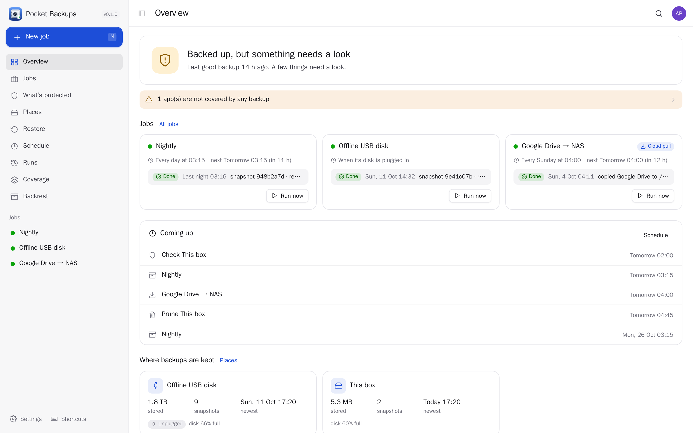</p>

<table>
  <tr>
    <td width="50%">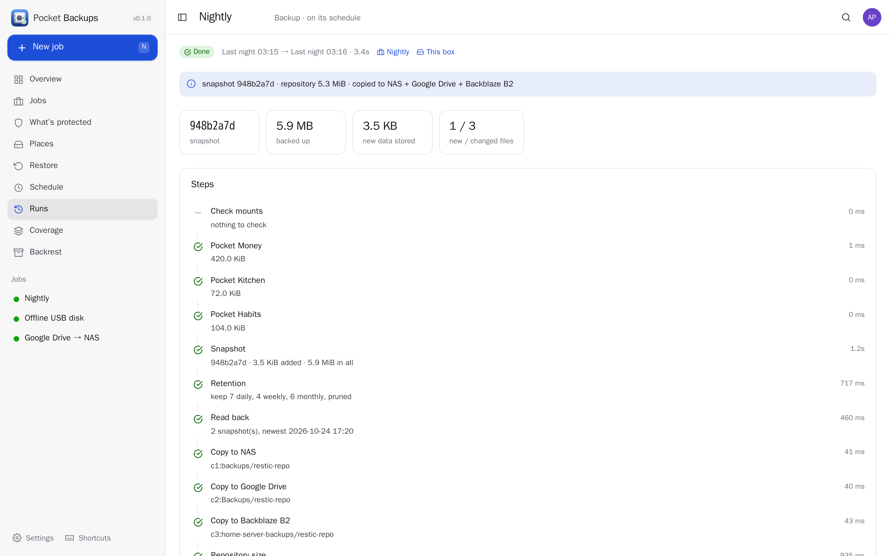</td>
    <td width="50%">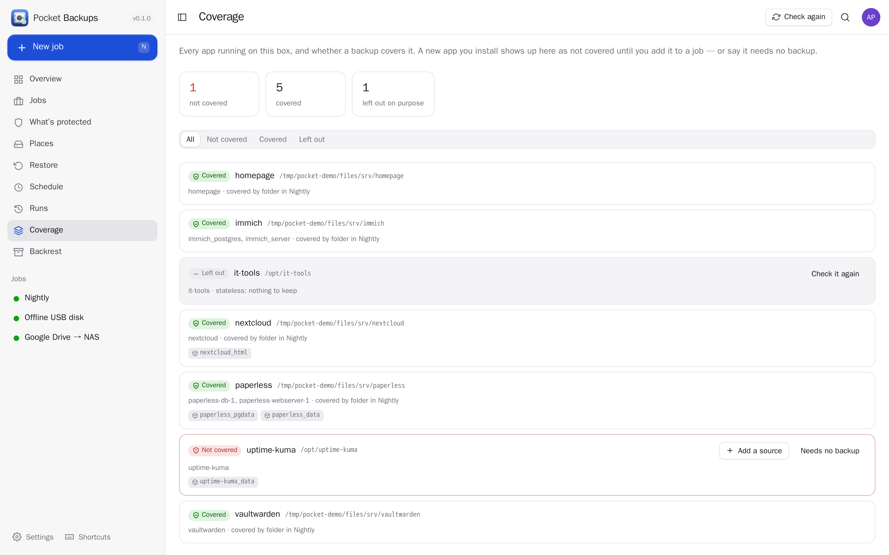</td>
  </tr>
  <tr>
    <td align="center"><sub>A run, step by step: every dump, the snapshot, each copy, with the log.</sub></td>
    <td align="center"><sub>Coverage: every running app, and whether a backup covers it.</sub></td>
  </tr>
  <tr>
    <td width="50%">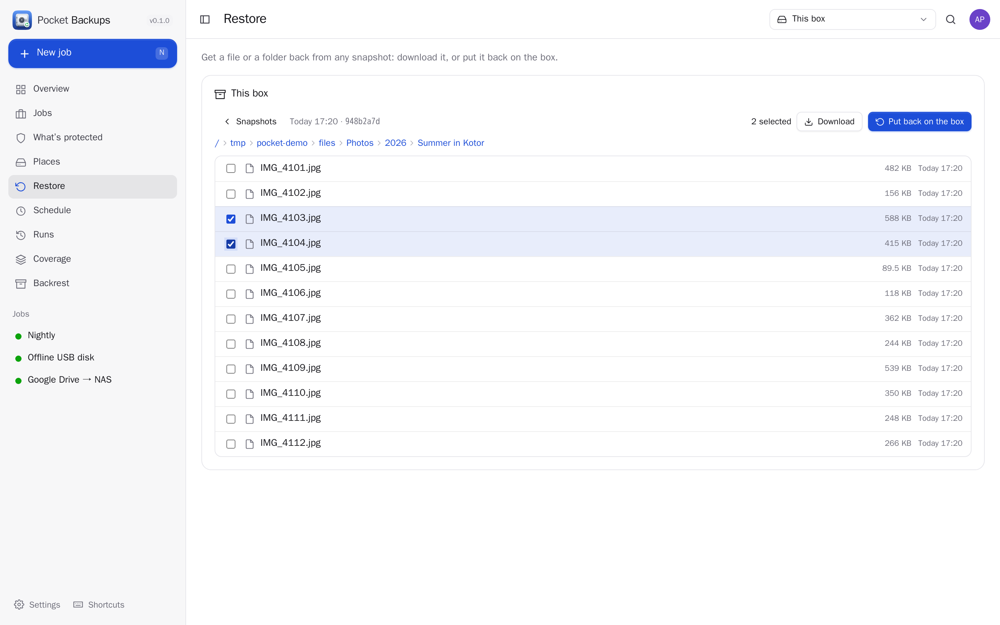</td>
    <td width="50%">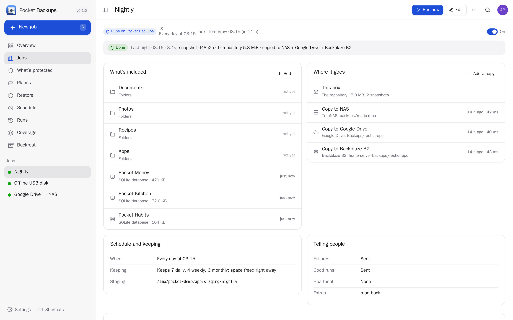</td>
  </tr>
  <tr>
    <td align="center"><sub>Restore: pick a night, browse it like a folder, download a file or put it back.</sub></td>
    <td align="center"><sub>A job: what it protects, where it goes, when, how long snapshots are kept.</sub></td>
  </tr>
  <tr>
    <td width="50%">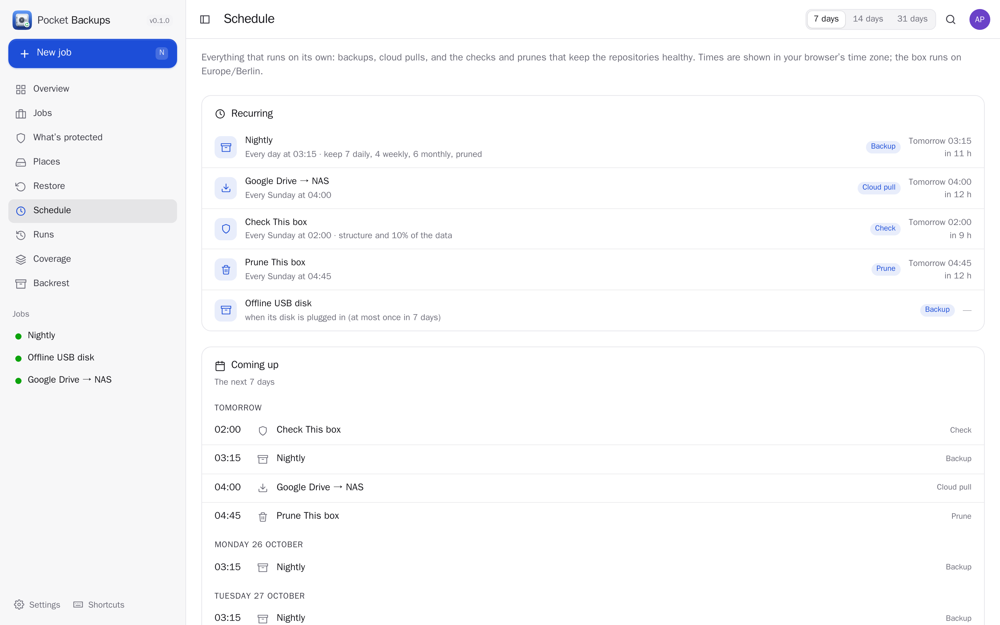</td>
    <td width="50%">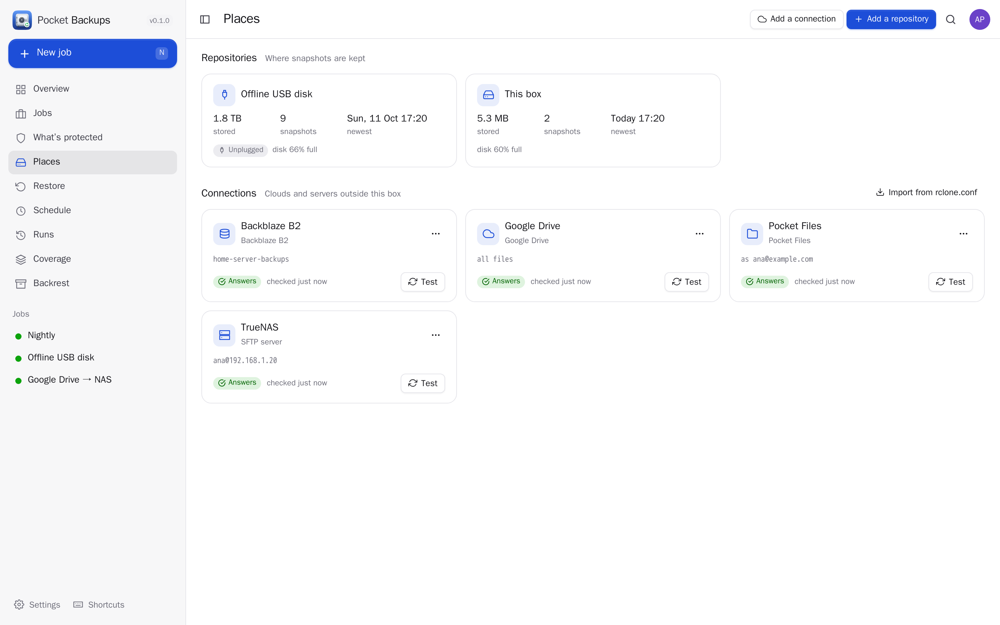</td>
  </tr>
  <tr>
    <td align="center"><sub>Schedule: every backup, pull, check and prune that runs on its own, and what comes up next.</sub></td>
    <td align="center"><sub>Places: repositories and the clouds, NAS and disks they are copied to.</sub></td>
  </tr>
  <tr>
    <td width="50%">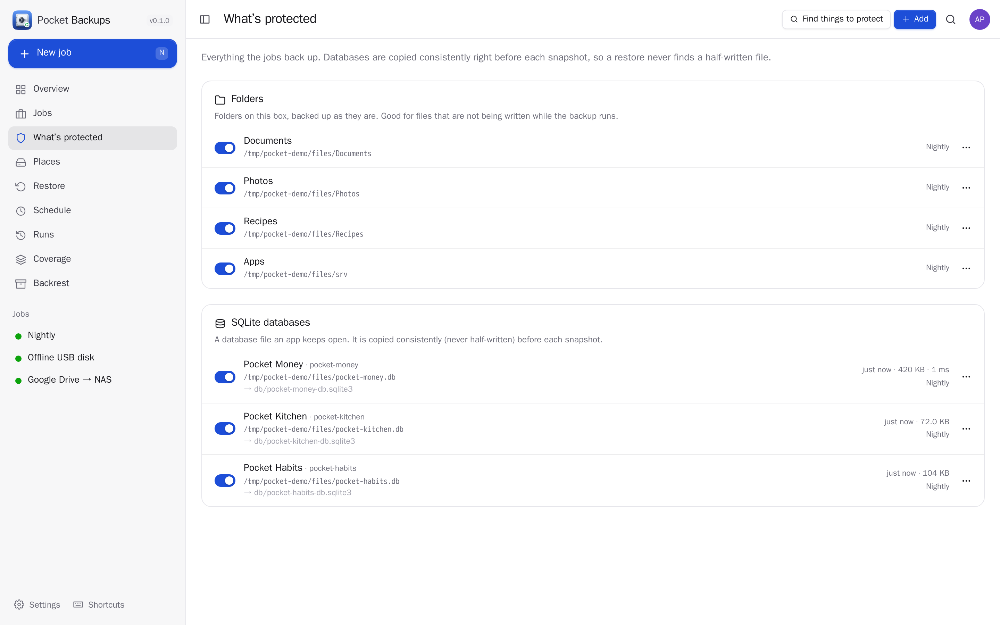</td>
    <td width="50%">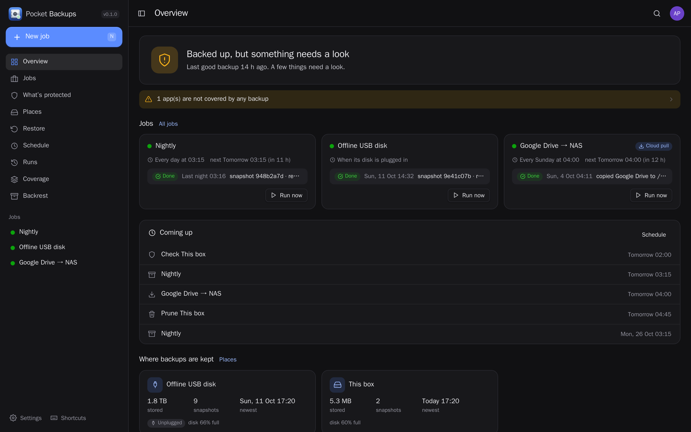</td>
  </tr>
  <tr>
    <td align="center"><sub>What's protected: folders, SQLite, PostgreSQL, MariaDB, Docker volumes, files and commands.</sub></td>
    <td align="center"><sub>Dark mode.</sub></td>
  </tr>
</table>

<p align="center">
  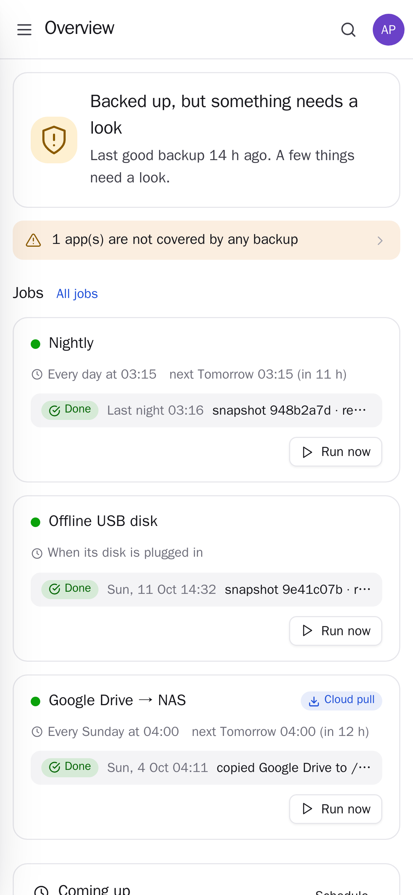&nbsp;&nbsp;
  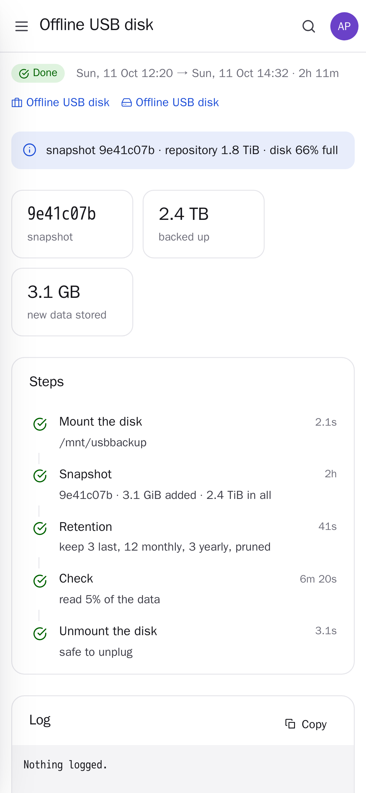
</p>

## What it does

**What to protect** — *sources*
- Folders, with excludes.
- Live databases, consistently: SQLite (an online snapshot, never a copy of a file that is being written),
  PostgreSQL and MariaDB/MySQL dumped inside their own containers (credentials read from the container's
  environment; table data you can rebuild can be left out).
- Docker volumes, files from inside a container (root-owned keys and configs your user cannot read), the output of
  a command in a container, and — with host access — a command on the host (`/etc`, package lists).
- **Discover** suggests sources from what is running: database containers, SQLite files, named volumes.
- Every dump is written atomically: a failed one never replaces last night's good copy.

**Where it goes** — *repositories and copies*
- Encrypted, deduplicated [restic](https://restic.net) repositories: a folder on the box, a USB disk, or any cloud
  through [rclone](https://rclone.org).
- After each snapshot the repository is copied on: an exact mirror to the NAS (SFTP), Google Drive, OneDrive,
  Dropbox, Backblaze B2, S3 or [Pocket Files](https://github.com/abjelosevic88/pocket-homelab-files), or the new
  snapshots into another repository that keeps its own history.
- Sign in to Google, Microsoft or Dropbox from the app, paste a token from `rclone authorize`, or import the remotes
  of an existing `rclone.conf`.
- A failed check **pauses the copies** so a damaged repository can never overwrite the last good copy elsewhere.

**When** — *jobs*
- Schedules, retention (keep last/daily/weekly/monthly/yearly), prune, checks, a read-back after each snapshot —
  all of it on one **Schedule** page with what comes up next (the clocks going back never run a job twice).
- Refuses to back up a NAS share that is not mounted (an empty folder would look like "everything was deleted").
- An offline USB disk: mounted for the backup, verified, unmounted and powered down after — and with
  **Run when plugged in**, plugging it in is all a monthly backup takes. You are told when it is safe to unplug.
- Pull jobs bring a cloud folder home (Google Drive → NAS, Shared with me included, Docs exported to Office files).
- A heartbeat URL (Uptime Kuma, Healthchecks) so silence is noticed too.

**Restore**
- Pick a night, browse the snapshot like a folder, download a file (or a folder as a zip), or put files back —
  where they were, or somewhere new.

**Knowing**
- An overview anyone understands: "Everything is backed up. Last good backup 6 h ago."
- Notifications (Apprise, ntfy, a webhook) for failures and warnings, and "Backup OK" if you like.
- The coverage check: every running container belongs to a backup, or is skipped on purpose — a new app you forgot
  shows up the same night.
- A size report per app for [Homepage](https://gethomepage.dev) and a widget endpoint.

## On top of Backrest — or without it

You don't need [Backrest](https://github.com/garethgeorge/backrest): Pocket Backups runs restic itself, on its own
schedules, and shows everything that runs on its own on the **Schedule** page. If you already use Backrest you can
keep it — import its repositories and plans, press **Install hooks**, and Backrest's plans call Pocket Backups for
everything around the snapshot instead of shell scripts — or move off it in one step: **Run them here instead**
takes each plan over with its folders, excludes, schedule and retention, and the repositories' check and prune
schedules, keeps Backrest's last backup in the history and switches the plans off in Backrest. The restic
repositories stay as they are. See [docs/backrest.md](docs/backrest.md).

## Run it

```sh
docker run -d --name pocket-backups -p 8080:8080 -v ./data:/data \
  -v /var/run/docker.sock:/var/run/docker.sock --group-add "$(getent group docker | cut -d: -f3)" \
  -v /srv:/srv:ro -e BASE_URL=https://backups.example.com -e SECURE_COOKIES=true \
  ghcr.io/abjelosevic88/pocket-homelab-backups:latest
```

Mount what you want to back up (read-only is enough for backing up; read-write to restore in place). The
[docker-compose.yml](docker-compose.yml) shows a full setup: your home at the same path, the Docker socket for
database dumps, host access for host commands and USB disks. Every option is in
[docs/configuration.md](docs/configuration.md); the API (and the Homepage widget) in [docs/api.md](docs/api.md).

## The Pocket apps

With [Pocket Core](https://github.com/abjelosevic88/pocket-homelab-core): one sign-in, Pocket Files as a place for
backups (through Core, nothing to paste), `backups.run.finished` / `backups.run.failed` events, and other apps can
read whether the box is backed up (`backups:read`). Backups are box-wide: admins manage them; everyone else sees
whether the box is protected, nothing more.

## Built with

Go, chi, SQLite (modernc), React 19, Vite; restic 0.19 and rclone 1.74 in the image. Works alone, with Backrest
underneath, and with [Pocket Core](https://github.com/abjelosevic88/pocket-homelab-core). MIT licensed.
